# ⚡ Awesome Visual API Workflow & Orchestration Builder 🚀

  

  
  
  
  
  

> 🌟 A curated list of top **Visual API Workflow and Orchestration Builder** platforms — covering open-source self-hostable tools and commercial SaaS solutions for designing, automating, chaining, and orchestrating API-driven pipelines, event-driven integrations, and agentic microservices with low-code visual canvases. 🎨⚡

---

## 📋 Table of Contents

- [📈 Sector Overview & Market Dynamics](#-sector-overview--market-dynamics)
- [🟦 SaaS / Hosted Platforms](#-saas--hosted-platforms)
- [🟩 Open-Source Software](#-open-source-software)
- [📊 Feature Comparison Matrix](#-feature-comparison-matrix)
- [🤝 Contributing](#-contributing)
- [💖 Support](#-support)
- [⭐ Star History](#-star-history)
- [📄 License](#-license)

---

## 📈 Sector Overview & Market Dynamics

The integration platform and workflow orchestration market is valued between **$15B and $25B+** (with the broader iPaaS sector expanding toward **$70B–$100B+** at an aggressive CAGR of ~25–30%), driven by rapid API proliferation, distributed microservices, and autonomous AI agent workflows. The sector exhibits **moderate-to-high fragmentation** rather than a winner-take-all monopoly: while legacy mega-vendors and multi-billion-dollar enterprise platforms command high-ticket enterprise contracts, developer-centric low-code tools and open-source engines capture massive grassroots adoption through custom code extensibility, data privacy, and self-hosted deployments. 🌐🔍

---

## 🟦 SaaS / Hosted Platforms

Commercial, cloud-hosted visual API workflow builders and iPaaS platforms, sorted by company valuation and annual recurring revenue (descending). 💼☁️

| Platform | Company Valuation / Revenue | Starting Tier Pricing | Free Tier / Trial Limits | Best For |
|---|---|---|---|---|
| **[Make](https://www.make.com/)** 🟣 | **$13B** valuation *(parent Celonis)* / ~$52.6M ARR | **$9.00/month** (Core plan, billed annually) | **Free forever:** 1,000 credits/mo, 2 active scenarios, 15-min min scheduling interval, 512 MB data transfer | Complex multi-step API mapping & visual data transformations 🔄 |
| **[Workato](https://www.workato.com/)** 🟡 | **$5.7B** valuation / ~$150M ARR | **$75.00/month** (Self-service Pro tier; Enterprise custom from $20k+/yr) | **Free evaluation tier:** One-time grant of 50,000 credits (no expiration, does not refresh monthly) | Enterprise-grade governance, IT security & cross-app automations 🏢 |
| **[Postman Flows](https://www.postman.com/product/flows/)** 🟠 | **$5.6B** valuation / ~$313M ARR | **$9.00/user/month** (Solo plan billed annually; Team at $19/user/mo) | **Free forever:** 25 complimentary Flows credits/mo, up to 10 snapshots per flow, solo workspace (1 user) | Chaining REST/GraphQL APIs within existing Postman collections 📮 |
| **[Zapier](https://zapier.com/)** 🟧 | **$5.0B** valuation / ~$320M ARR | **$19.99/month** (Professional tier, billed annually) | **Free forever:** 100 tasks/mo, 2-step single-trigger/single-action Zaps only, 15-minute polling interval | Simple trigger-action integrations across 7,000+ commercial web apps ⚡ |
| **[Tray.io](https://tray.ai/)** 🔵 | **$600M** valuation / ~$71M ARR | **$50.00/month** (Helix / Builder tier; Enterprise custom) | **30-day free trial:** Up to 1,000,000 tasks, full access to 600+ connectors, no credit card required | Enterprise iPaaS with low-code builder & Headless AI agent SDK 🧩 |
| **[Pipedream](https://pipedream.com/)** 🟢 | **$80M** valuation *(acquired by Workday)* / ~$3.5M ARR | **$29.00/month** (Basic tier; Startup Connect at $99/mo) | **Free forever:** ~100 compute credits/mo, 3 active workflows, 750 seconds/day test runtime, community support | Developer-first serverless event workflows with Node.js & Python 🐍 |

---

## 🟩 Open-Source Software

Self-hosted, community-driven visual API workflow engines and orchestration builders. Listed in order of GitHub_Stars (descending). 💻🔓

### 1. [n8n](https://github.com/n8n-io/n8n)  🌟
- **Stack:** TypeScript / Node.js | **License:** Sustainable Use License (source-available)
- **Overview:** The most widely adopted source-available workflow automation platform, featuring a visual canvas, 500+ native integrations, and full AI/MCP agent orchestration. Any external API can be queried via standard HTTP nodes, and workflows seamlessly blend visual wiring with custom JavaScript and Python scripts. Features include real-time execution replays, human-in-the-loop approvals, and webhook triggers. 🔀

### 2. [Dify](https://github.com/langgenius/dify)  🤖
- **Stack:** Python / TypeScript / Next.js | **License:** Apache 2.0
- **Overview:** An open-source LLM app development and agent orchestration platform with a visual drag-and-drop workflow canvas. Enables orchestrating complex multi-agent workflows, tool APIs, RAG pipelines, and model evaluation with production-grade backend deployment. 🧠

### 3. [Langflow](https://github.com/langflow-ai/langflow)  🌊
- **Stack:** Python / React | **License:** MIT
- **Overview:** A dynamic visual framework and UI for building multi-agent AI systems, API chains, and retrieval-augmented generation (RAG) applications. Connects components, custom Python functions, and REST endpoints directly via interactive flowcharts. 💬

### 4. [Flowise](https://github.com/FlowiseAI/Flowise)  🧭
- **Stack:** TypeScript / Node.js | **License:** Apache 2.0
- **Overview:** A visual canvas for building customized LLM orchestration flows and AI agents. Offers three specialized builders: Assistant (single-agent conversational), Chatflow (conversational chains), and Agentflow (multi-agent orchestration). Natively interfaces with 100+ API tools, vector stores, and custom webhooks. 🔗

### 5. [Huginn](https://github.com/huginn/huginn)  🦅
- **Stack:** Ruby | **License:** MIT
- **Overview:** A pioneer in self-hosted automated event-driven workflows. Allows users to create personal "agents" that monitor the web, scrape structured data from APIs, watch RSS feeds, and trigger outbound webhook actions on a visual event graph. 📡

### 6. [Conductor](https://github.com/conductor-oss/conductor)  🎼
- **Stack:** Java / Spring Boot | **License:** Apache 2.0
- **Overview:** An enterprise-scale, event-driven orchestration engine created at Netflix. Provides resilient microservice and API workflow execution, state tracking, and branching logic with visual topology rendering for distributed architectures. 🏗️

### 7. [Kestra](https://github.com/kestra-io/kestra)  🚀
- **Stack:** Java / Vue.js | **License:** Apache 2.0
- **Overview:** An event-driven, declarative workflow orchestrator that treats workflows as code (YAML) while offering a visual topology designer, real-time debugging, and hundreds of plugins for cloud APIs, databases, and microservices. 📑

### 8. [Activepieces](https://github.com/activepieces/activepieces)  🧩
- **Stack:** TypeScript | **License:** MIT (Community Edition)
- **Overview:** A 100% MIT-licensed open-source automation platform serving as a permissive alternative to n8n. Features 200+ native "pieces", looping, branching, custom NPM code execution, auto-retries, human approvals, and air-gapped deployment support. 🛡️

### 9. [Node-RED](https://github.com/node-red/node-red)  🔴
- **Stack:** Node.js / JavaScript | **License:** Apache 2.0
- **Overview:** An established open-source low-code flow editor governed by the OpenJS Foundation. Built specifically for event-driven automation, hardware devices, IoT, and edge-computing message routing across MQTT, WebSocket, and HTTP endpoints. 🌐

### 10. [Windmill](https://github.com/windmill-labs/windmill)  💨
- **Stack:** Rust / Svelte / PostgreSQL | **License:** AGPL-3.0 (Community Edition)
- **Overview:** A high-performance, code-first developer platform that converts scripts (Python, TypeScript, Go, Bash, SQL) into visual workflows, auto-generated UI forms, and webhooks. Built with a Rust execution engine claiming 13x faster throughput than Airflow. ⚡

### 11. [Automatisch](https://github.com/automatisch/automatisch)  ⚙️
- **Stack:** JavaScript / React / Node.js | **License:** AGPL-3.0
- **Overview:** A privacy-conscious, self-hosted Zapier alternative for teams subject to strict GDPR or internal data compliance regulations, allowing visual trigger-action integrations without sending sensitive payload data to external cloud services. 🔒

### 12. [Open Flow](https://github.com/oomol-lab/open-flow)  💡
- **Stack:** TypeScript / Node.js | **License:** Open Source
- **Overview:** A visual workflow platform built for AI-assisted orchestration with inspectable code verification. Integrates with OpenConnector to communicate with external APIs securely without exposing credentials inside canvas graphs. 🔍

### 13. [Fluxify](https://github.com/Fluxify-rest/Fluxify)  ⚡
- **Stack:** Bun / TypeScript | **License:** Apache 2.0
- **Overview:** A low-code agentic backend platform that compiles visual workflows directly into native JavaScript executed on the high-speed Bun runtime, eliminating runtime graph-walking latency for API endpoints. 🏎️

### 14. [MEL Agent](https://github.com/cedricziel/mel-agent)  🧪
- **Stack:** Go / React / PostgreSQL | **License:** Open Source
- **Overview:** An AI-native workflow automation platform with dual worker execution (embedded and distributed) designed specifically for LLM step traces, live preview debugging, and HTTP webhook integration. 🔬

### 15. [napflow](https://github.com/nickosh/napflow)  💤
- **Stack:** Python / YAML | **License:** Open Source
- **Overview:** A local-first, git-friendly, node-based flow editor built as an open, Python-powered alternative to Postman Flows. Stores workflows as simple YAML and Python files for version control, composability, and headless CI execution. 🐍

---

## 📊 Feature Comparison Matrix

| Platform | Deployment | License | Visual Canvas | Code Extensibility | AI / MCP Ready | Primary Target Use Case |
|---|---|---|---|---|---|---|
| **Make** 🟣 | Cloud SaaS | Proprietary | ✅ | JSONata / Formulas | ✅ | Enterprise visual data integration 🔄 |
| **Workato** 🟡 | Cloud SaaS | Proprietary | ✅ | Connector SDK | ✅ | Enterprise iPaaS & governed IT automation 🏢 |
| **Postman Flows** 🟠 | Cloud SaaS | Proprietary | ✅ | JavaScript | ✅ | API debugging & collection chaining 📮 |
| **Zapier** 🟧 | Cloud SaaS | Proprietary | ✅ | Code by Zapier (limited) | ✅ | No-code app integration ⚡ |
| **Tray.io** 🔵 | Cloud SaaS | Proprietary | ✅ | Headless SDK / Code | ✅ | Scalable multi-tenant iPaaS 🧩 |
| **Pipedream** 🟢 | Cloud SaaS | Proprietary | ✅ | Node.js / Python | ✅ | Serverless event triggers & webhooks 🐍 |
| **n8n** 🌟 | Self-Hosted / Cloud | Sustainable Use | ✅ | JavaScript / Python | ✅ | Versatile self-hosted workflow automation 🔀 |
| **Dify** 🤖 | Self-Hosted / Cloud | Apache 2.0 | ✅ | Python / REST | ✅ | LLM agent workflows & RAG pipelines 🧠 |
| **Langflow** 🌊 | Self-Hosted / Cloud | MIT | ✅ | Python | ✅ | Visual multi-agent & prompt engineering 💬 |
| **Flowise** 🧭 | Self-Hosted / Cloud | Apache 2.0 | ✅ | JavaScript / Custom Code | ✅ | Drag-and-drop LLM agent flows 🔗 |
| **Huginn** 🦅 | Self-Hosted | MIT | ✅ | Ruby / Shell | ⚠️ | Event monitoring & web scraping 📡 |
| **Conductor** 🎼 | Self-Hosted / Cloud | Apache 2.0 | ✅ | Polyglot (Java, Python, Go) | ✅ | Resilient microservice API orchestration 🏗️ |
| **Kestra** 🚀 | Self-Hosted / Cloud | Apache 2.0 | ✅ | Python, Shell, Node, SQL | ✅ | Declarative orchestration & data pipelines 📑 |
| **Activepieces** 🧩 | Self-Hosted / Cloud | MIT | ✅ | NPM / TypeScript | ✅ | Permissively licensed Zapier alternative 🛡️ |
| **Node-RED** 🔴 | Self-Hosted | Apache 2.0 | ✅ | JavaScript | ⚠️ | IoT, hardware & edge event wiring 🌐 |
| **Windmill** 💨 | Self-Hosted / Cloud | AGPL-3.0 | ✅ | Python / TS / Go / Bash | ✅ | Code-first developer script automation ⚡ |
| **Automatisch** ⚙️ | Self-Hosted | AGPL-3.0 | ✅ | JavaScript | ⚠️ | Privacy-focused self-hosted automation 🔒 |
| **Open Flow** 💡 | Self-Hosted | Open Source | ✅ | TypeScript | ✅ | AI-assisted inspectable workflow creation 🔍 |
| **Fluxify** ⚡ | Self-Hosted | Apache 2.0 | ✅ | JavaScript (Bun compiled) | ✅ | High-throughput compiled API pipelines 🏎️ |
| **MEL Agent** 🧪 | Self-Hosted | Open Source | ✅ | Go SDK | ✅ | AI-native step tracing & LLM flows 🔬 |
| **napflow** 💤 | Self-Hosted / Local | Open Source | ✅ | Python | ⚠️ | Git-friendly API testing in CI/CD 🐍 |

---

## 🤝 Contributing

Contributions are welcome! If you know of an open-source or notable Visual API Workflow and Orchestration platform that should be included:

1. Fork this repository 🍴.
2. Add your entry under the appropriate section in descending order (by Stars_Count for open-source or revenue/valuation for SaaS) 📊.
3. Ensure the project is active (updated within the last 12 months) and relevant to visual API orchestration 🎯.
4. Submit a Pull Request with a clear description of the project and its license 🚀.

---

## 💖 Support

Thank you for visiting and using this curated directory! If you find this resource helpful, please consider supporting the project:

- ⭐ **Star this repository** to help others discover it!
- 🍴 **Fork and contribute** new tools, corrections, or improvements!
- 📢 **Share** with your friends, colleagues, and developer communities!
- ☕ **Buy me a coffee / Sponsor:** If you'd like to support ongoing maintenance and new open-source initiatives, consider sponsoring via the [GitHub Sponsors Dashboard](https://github.com/sponsors/ishandutta2007). Every contribution is deeply appreciated! ❤️

---

##  Star History

---

## 📄 License

This repository and curated list are released under the [Creative Commons Zero v1.0 Universal](LICENSE) (CC0 1.0) Public Domain Dedication. Listed third-party products, trademarks, and repositories remain the property and copyright of their respective owners. ⚖️

---

⭐ **Found this guide helpful? Give it a star on GitHub!** ⭐
